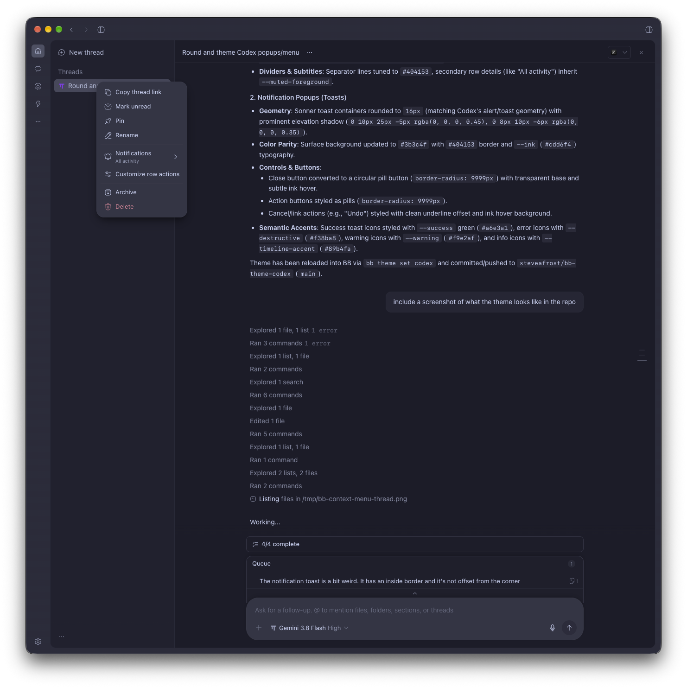

# Codex Theme for bb

A custom theme for [bb](https://getbb.app) bringing visual and layout parity with the OpenAI Codex / ChatGPT desktop app.



## Features

- **Codex / ChatGPT Typography**: Uses the macOS system font (`SF Pro`) matching the desktop app, with tuned `430` text weight and 14px scale.
- **Codex Send Indicator Arrow**: Replaces the return icon (`CornerDownLeft`) with the upward send arrow from Codex (`arrow-up-lg-light-20`).
- **Codex Composer Geometry**:
  - `26px` rounded container corners (matching Codex's `calc(var(--spacing) * 7)` radius).
  - Compact ~72px box height with proportional breathing room.
  - Circular `32px` send button (`rounded-full`).
- **Color Parity**:
  - `#3b3c4f` composer background and `#404153` border sampled directly from Codex dark mode.
  - Preserves native theme contrast, focus states, and disabled button behavior.
- **Codex Context Menus & Dropdowns**:
  - `16px` rounded container corners (matching Codex's `--menu-radius: var(--radius-2xl)`).
  - Concentric `10px` rounded menu items with tuned padding, hover states, and preserved destructive actions.
  - `#3b3c4f` elevated surface background and `#404153` border.
- **Codex Notification Popups**:
  - `16px` rounded toast containers matching Codex alert geometry.
  - `#3b3c4f` elevated background, `#404153` border, and rich elevation shadow.
  - Semantic icon accents, clean typography, and pill action buttons.
- **Decluttered View**: Removes the top-right collapse chevron and bottom composer footer for a minimal, focused prompt area.
- **Catppuccin Palette**: Retains full Catppuccin syntax highlighting and terminal ANSI colors.

## Installation

Clone into your custom themes directory and activate it. The folder name is the displayed theme name:

```bash
git clone https://github.com/steveafrost/bb-theme-codex.git ~/.bb/theme/Codex
bb theme set Codex
```

The theme takes effect immediately in running windows without a restart.

## Updating

```bash
git -C ~/.bb/theme/Codex pull
bb theme set Codex
```

## Reset / Uninstall

To return to the default theme:

```bash
bb theme reset
```
